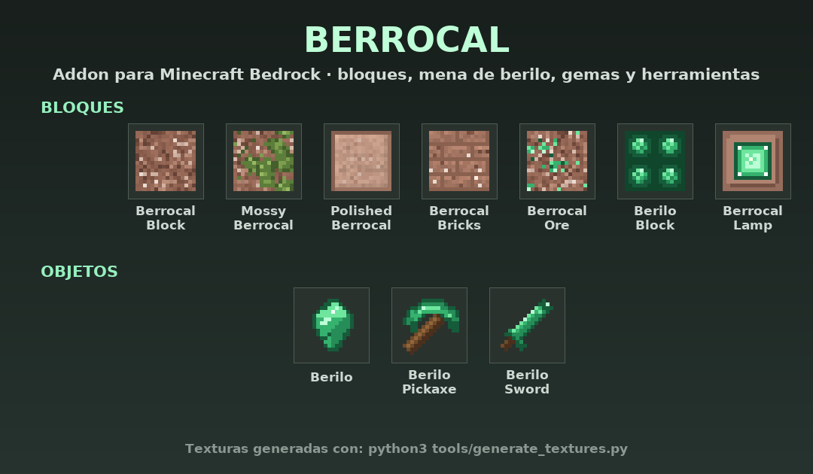

# Berrocal

**Addon de Minecraft Bedrock** con un mundo de granito: bloques de berrocal, mena de berilo,
gemas y herramientas de berilo. Texturas, recetas, generación en el mundo e idiomas (español e inglés).



---

## ⬇️ Instalar desde GitHub

### Opción 1 — Descargar el `.mcaddon` (la más fácil, recomendada)

1. Entra en **[Releases → última versión](https://github.com/lyanvalentinmail-prog/McAddon/releases/latest)**.
2. Descarga **`Berrocal.mcaddon`** (también puedes usar el enlace directo:
   <https://github.com/lyanvalentinmail-prog/McAddon/releases/latest/download/Berrocal.mcaddon>).
3. Abre el archivo descargado:
   - **Android:** tócalo desde el explorador de archivos → *Abrir con Minecraft*.
   - **Windows / iOS:** haz doble clic (o «Abrir con → Minecraft»).
   - **Consola / Kindle:** usa un móvil o PC con la misma cuenta y luego sincroniza; o copia los
     packs a mano como se explica más abajo.
4. Minecraft importará **los dos packs** (comportamiento y recursos) de golpe.

> Si prefieres solo una parte, en la misma release están `Berrocal_BP.mcpack` (comportamiento)
> y `Berrocal_RP.mcpack` (recursos).

### Opción 2 — Descargar el repositorio en ZIP

1. Pulsa **`Code` → `Download ZIP`** en
   <https://github.com/lyanvalentinmail-prog/McAddon>.
2. Descomprime el ZIP.
3. Copia las carpetas **`Berrocal_BP`** y **`Berrocal_RP`** dentro de la carpeta de Minecraft:
   - **Windows:** `%localappdata%\Packages\Microsoft.MinecraftUWP_8wekyb3d8bbwe\LocalState\games\com.mojang\development_behavior_packs` y `...\development_resource_packs`
   - **Android:** `Android/data/com.mojang.minecraftpe/files/games/com.mojang/development_behavior_packs` y `.../development_resource_packs`
   - **iOS:** `Archivos → En mi iPhone → Minecraft → games/com.mojang/development_behavior_packs` y `.../development_resource_packs`
4. Abre Minecraft y activa los packs en tu mundo (ver abajo).

### Opción 3 — Clonar con Git (para desarrollar)

```bash
git clone https://github.com/lyanvalentinmail-prog/McAddon.git
cd McAddon
python3 tools/build.py          # genera dist/Berrocal.mcaddon
```

---

## ✅ Activar el addon en un mundo

1. Crea o edita un mundo → **Ajustes del mundo**.
2. En **Packs de comportamiento**, busca *Berrocal · Comportamiento* y actívalo.
3. En **Packs de recursos**, busca *Berrocal · Recursos* y actívalo
   (si usas el `.mcaddon`, se activa solo; si no, actívalo a mano).
4. Listo. El pack de comportamiento depende del de recursos, así que Minecraft los vincula automáticamente.

> La generación de mena funciona en **chunks nuevos**. En un mundo ya explorado, la mena aparecerá
> en zonas que aún no hayas visitado (o usa `/give` para conseguir berilo al instante).

---

## 📦 Contenido

### Bloques

| Bloque | ID | Notas |
| --- | --- | --- |
| Bloque de Berrocal | `berrocal:berrocal_block` | Granito decorativo, se pica con pico |
| Berrocal Musgoso | `berrocal:mossy_berrocal` | Variante con musgo |
| Berrocal Pulido | `berrocal:polished_berrocal` | Versión lisa y clara |
| Ladrillos de Berrocal | `berrocal:berrocal_bricks` | Para construcción |
| Mena de Berilo | `berrocal:berrocal_ore` | Genera bajo tierra entre Y=0 y Y=56; suelta 1–2 berilos |
| Bloque de Berilo | `berrocal:berilo_block` | Bloque de gema (9 berilos) |
| Lámpara de Berrocal | `berrocal:berrocal_lamp` | Nivel de luz 15 |

### Objetos

| Objeto | ID | Notas |
| --- | --- | --- |
| Berilo | `berrocal:berilo` | Gema principal del addon |
| Pico de Berilo | `berrocal:berilo_pickaxe` | 1420 de durabilidad, daño 4, velocidad de pico de diamante |
| Espada de Berilo | `berrocal:berilo_sword` | 1680 de durabilidad, daño 8 |

### Recetas

| Resultado | Receta |
| --- | --- |
| Berrocal Pulido ×4 | 2×2 de Bloque de Berrocal (o cortapiedras) |
| Ladrillos de Berrocal ×4 | 2×2 de Berrocal Pulido |
| Berrocal Musgoso | Bloque de Berrocal + enredadera |
| Bloque de Berilo | 3×3 de Berilo |
| Berilo ×9 | Bloque de Berilo |
| Lámpara de Berrocal ×2 | Berrocal Pulido en cruz + Berilo en el centro |
| Pico de Berilo | 3 Berilos arriba + 2 palos |
| Espada de Berilo | 2 Berilos en vertical + 1 palo |

### Comandos útiles

```mcfunction
/give @s berrocal:berilo 16
/give @s berrocal:berilo_pickaxe
/give @s berrocal:berilo_sword
/give @s berrocal:berrocal_lamp 8
/setblock ~ ~ ~ berrocal:berrocal_ore
```

---

## 🗂️ Estructura del repositorio

```
Berrocal_BP/                 Pack de comportamiento
├── manifest.json            UUIDs y dependencia del pack de recursos
├── blocks/                  7 bloques (geometría, material_instances, dureza, luz)
├── items/                   3 objetos (icono, durabilidad, daño, digger)
├── recipes/                 9 recetas (mesa de crafteo y cortapiedras)
├── loot_tables/blocks/      Drop de la mena de berilo
├── features/                Feature de mena (ore_feature)
├── feature_rules/           Regla que reparte la mena por el Overworld
└── texts/                   Nombres de los packs (es/en)

Berrocal_RP/                 Pack de recursos
├── manifest.json
├── textures/blocks/         7 texturas de bloque (16×16)
├── textures/items/          3 iconos de objeto (16×16)
├── textures/terrain_texture.json
├── textures/item_texture.json
└── texts/                   Traducciones de bloques/objetos (es_ES, es_MX, en_US)

tools/
├── generate_textures.py     Genera todas las texturas (pixel art procedural)
├── build.py                 Crea dist/Berrocal.mcaddon + .mcpacks
└── validate.py              Valida JSON, UUIDs, texturas, idiomas y recetas

docs/preview.png             Imagen de la tabla de texturas
.github/workflows/build.yml  CI: valida, empaqueta y publica releases
```

---

## 🛠️ Desarrollo

Requisitos: **Python 3.9+** y **Pillow** (solo para regenerar texturas).

```bash
pip install pillow

python3 tools/generate_textures.py   # vuelve a dibujar todas las texturas y el preview
python3 tools/validate.py            # comprueba que todo está correcto
python3 tools/build.py               # genera dist/Berrocal.mcaddon (+ packs sueltos)
```

### Publicar una nueva versión en GitHub

1. Sube el número de versión en `Berrocal_BP/manifest.json`, `Berrocal_RP/manifest.json`
   y en la dependencia del BP.
2. Haz commit y push a `main`.
3. Crea y sube una etiqueta:

```bash
git tag v1.0.1
git push origin v1.0.1
```

El workflow **Construir y publicar addon** valida el addon, empaqueta el `.mcaddon` y lo adjunta
automáticamente a la release de esa etiqueta. El enlace `releases/latest/download/Berrocal.mcaddon`
siempre apunta a la última versión.

---

## 📱 Compatibilidad

- Minecraft Bedrock **1.21.80 o superior** (bloques con geometría explícita y `item_specific_speeds`).
- Funciona en Windows, Android, iOS, consolas (a través del importador) y en servidores Bedrock.
- No requiere experimentos activados.

## 📄 Licencia

[MIT](LICENSE) © 2026 lyanvalentin. Puedes usar, modificar y redistribuir el addon citando el origen.
Minecraft es una marca de Mojang Studios; este proyecto no está afiliado a Mojang ni a Microsoft.
